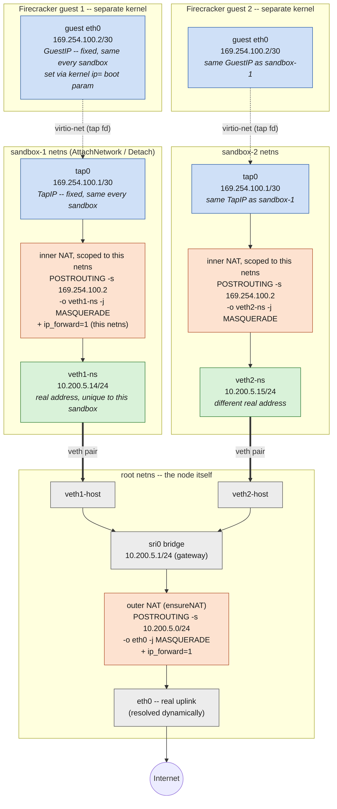

# SRI Network Model — Design

## Goals

- Give every sandbox its own network namespace + egress to the
  internet, using a shared bridge, a veth pair and tap device per
  sandbox, and `iptables` `FORWARD`/NAT rules.
- Networking is a self-contained concern: its own gRPC service, its
  own config section, its own package. `RuntimeService` (and
  whatever backs it, Firecracker/jailer today) depends on it as a
  client; it never depends back.
- Run unmodified across multiple nodes, each pre-assigned its own
  IP range.

## Non-goals (explicitly out of scope)

- Multi-tenancy (groups/realms). Every sandbox on a node can reach
  every other sandbox on that node by default -- full mesh
  reachability, not scoped to tenant groups.
- Cross-node sandbox reachability (no overlay, no BGP, no VXLAN).
  Each node's sandboxes talk to each other and to the internet;
  nothing about sandbox-to-sandbox traffic *between* nodes.
- Deciding how a node gets its CIDR. That's an input to this design
  (an operator, or whatever system provisions the node, writes it
  into config), not something SRI negotiates itself.

## Service boundary: `NetworkService`

A third `api.proto` service, next to `RuntimeService` and
`RootFSService`, owned by its own package
(`internal/backbone/network`, say) with no knowledge of internal
concepts at all, it only ever talks in sandbox IDs and generic
network handles.

```
service NetworkService {
  rpc AttachNetwork(AttachNetworkRequest) returns (AttachNetworkResponse) {}
  rpc DetachNetwork(DetachNetworkRequest) returns (DetachNetworkResponse) {}
}

message AttachNetworkRequest  { string sandbox_id = 1; }
message AttachNetworkResponse {
  string netns_path  = 1;  // -> jailer --netns
  string tap_device  = 2;  // -> Firecracker NetworkInterface.host_dev_name
  string ip_address  = 3;  // CIDR form, e.g. "10.200.5.14/24"
  string gateway_ip  = 4;
}

message DetachNetworkRequest  { string sandbox_id = 1; }
message DetachNetworkResponse {}
```

`AttachNetwork` does all the plumbing for one sandbox: create
its namespace, a tap device inside it (for the guest NIC), a veth
pair out to the node's bridge, assign an IP, set the default route.
`DetachNetwork` reverses it and releases the IP. Idempotent in both
directions, a repeated `AttachNetwork` for an already-attached
sandbox returns the existing handle rather than erroring, same spirit
as `PullRootFS`'s cache-hit behavior.

`RuntimeService` and `NetworkService` don't call each other, not
even `RuntimeService.CreateSandbox` calling `AttachNetwork`. Instead:
- Whoever orchestrates sandbox creation calls `AttachNetwork` before
  `CreateSandbox` for a given sandbox. That ordering is a caller
  contract, not something enforced in-process, `CreateSandbox` fails
  with a jailer/spawn error (missing namespace or tap device) if it's
  violated, not a validation error.

That's the "detached" part: swap Firecracker for something else later
and `NetworkService` doesn't change; change how IPs are allocated and
`CreateSandbox` doesn't change, right down to not depending on
`NetworkService` at all, just on two constants it happens to also
define.

## Config (`cfg`, TOML)

```toml
[network]
cidr        = "10.200.5.0/24"   # this node's assigned range
bridge_name = "sri0"
```

`cidr` is the one load-bearing, per-node value, everything else
has a sane fixed default. Validated at load time (parses as a CIDR,
has enough host bits to be worth running — reject anything smaller
than roughly a `/29`), fail-fast at startup, same pattern already
used for the jailer config section.

## Per-node setup (once, at startup)

Same shape as jailer's chroot-base-dir creation in `NewRuntime`: done
idempotently when the network package is constructed, not per
sandbox.

1. Create `bridge_name` if it doesn't exist; give it the first usable
   address in `cidr` (the gateway every sandbox routes through).
2. Resolve the node's real external interface dynamically (the
   interface backing the default route), and add one
   `iptables -t nat -A POSTROUTING -s <cidr> -o <that interface>
   -j MASQUERADE` rule, covering every sandbox this node will ever
   create.
3. `net.ipv4.ip_forward = 1`.

Everything from here on, per sandbox, is `AttachNetwork`/
`DetachNetwork`, no further node-level setup.

## Guest addressing and the inner NAT



Blue = fixed, identical in every sandbox (`TapIP`/`GuestIP`). Green =
the real, per-sandbox address `AttachNetwork`'s IP allocator hands
out. Orange = the two NAT boundaries a packet actually crosses on its
way out -- one inside the sandbox's own namespace, one in the root
namespace. Gray = shared node-level state, same for every sandbox.

The IP `AttachNetwork` allocates (`ip_address`/`gateway_ip` above) is
assigned to `veth-ns`, inside the sandbox's namespace, not to the
guest. The guest has its own, completely separate kernel on the other
side of the tap device; nothing about the namespace's own IP stack is
visible to it. Firecracker's own [network-setup.md] uses one `/30`
per VM, with the tap device holding one address and the guest the
other, NATed straight out the real uplink. That doesn't quite work
once a tap lives inside its own namespace (no access to the real
uplink directly), so this design nests a second NAT boundary instead
of a bridge:

- `tap0` gets a **fixed** address, `TapIP` = `169.254.100.1/30`; the
  guest configures the other half, `GuestIP` = `169.254.100.2/30`.
  Fixed, not per-sandbox, since each sandbox already has its own
  namespace.
- `ip_forward` is enabled *inside the sandbox's own namespace* (not
  just the root namespace's, which `ensureNAT` above already covers).
- One more `MASQUERADE` rule, scoped to the same namespace: `GuestIP`
  → `veth-ns`'s real, per-sandbox address. That address then crosses
  the *outer* NAT boundary (`ensureNAT`, root namespace) the same way
  any other sandbox's traffic does.

The guest configures itself without any help from `images/init` (or
any script at all): `CreateSandbox` appends `GuestIPKernelParam` — a
`ip=169.254.100.2::169.254.100.1:255.255.255.252::eth0:off` kernel
boot argument — to `KernelArgs` whenever jailer is enabled, and the
guest kernel's own built-in IP autoconfiguration (`CONFIG_IP_PNP`)
configures `eth0` from it before userspace ever starts. Same
mechanism Firecracker's own network-setup.md documents as the
alternative to a guest-side script. One upshot worth calling out:
this keeps `TapIP`/`GuestIP`/`GuestPrefixLen` defined in exactly one
place (`pkg/network`) — the guest image doesn't carry a second,
hand-synced copy of the same values.

Consequence: the guest never needs to learn its real, dynamically
allocated address at all — it always configures the same fixed pair,
every sandbox, every time. The one thing the real address *is* for,
from the guest's perspective, is the reverse direction: see "Host
reachability" below.

## Host reachability

`AttachNetwork`'s real address isn't just the guest's egress identity
-- it's also how the host (or another sandbox on the same bridge)
reaches the guest, on any port or protocol, without needing to enter
the sandbox's namespace at all.

A third rule, alongside the inner NAT above, scoped to the same
namespace:

```
iptables -t nat -A PREROUTING -d <real address> -j DNAT --to-destination 169.254.100.2
iptables -A FORWARD -d 169.254.100.2 -j ACCEPT
```

No port or protocol match -- a bare `-d` DNAT rewrites the
destination for every protocol conntrack can track (TCP, UDP, ICMP,
...), before the kernel decides "deliver locally" vs. "forward".
Nothing else ever listens on `veth-ns` itself, so redirecting
everything unconditionally is safe: there's no legitimate "local"
traffic on that address to preserve.

This makes `curl http://<real address>:<any port>` (or any other
protocol) from the plain root namespace -- no `ip netns exec` --
reach the guest directly. It also means any other sandbox on `sri0`
can reach this one the same way, which is already true by the
bridge's own full-mesh design (see "Non-goals" above). It does
*not* make the sandbox reachable from outside the host -- that would
need the equivalent rule at the *outer* NAT boundary (`ensureNAT`,
root namespace) too, which this design deliberately leaves out: this
rule's whole point is host (and sibling-sandbox) reachability, not
public exposure.

[network-setup.md]: https://github.com/firecracker-microvm/firecracker/blob/main/docs/network-setup.md

## IP assignment and tracking

The gateway address is reserved; everything else in `cidr` is
the allocatable pool, tracked as one directory of marker files —
`<state>/network/ips/`, one file per *allocated* address, filename
the address itself, content the sandbox ID that holds it. That
directory **is** the pool's state; there's no separate database to
keep in sync with it.

**`AttachNetwork(sandbox_id)`** walks the pool's offsets, skipping the
gateway, and for each one attempts to create
`<state>/network/ips/<ip>` with `O_CREATE|O_EXCL`:
- Fails with "exists" → that address is taken, try the next offset.
- Succeeds → that address is now this sandbox's, write `sandbox_id`
  as the file's content, done.

The `O_EXCL` create is an atomic kernel operation, so two concurrent
`AttachNetwork` calls racing for the same address can never both
win — whichever loses just moves on to the next offset. No locking
needed for the claim itself, same mechanism `pkg/idalloc` already
uses for jailer uid/gid — this is also exactly how CNI's `host-local`
IPAM plugin's disk backend works (same `O_EXCL`-per-address scheme),
not something invented for this design.

Rather than always starting the scan at the bottom of the range, keep
one extra file — `<state>/network/last_ip`, content: the last offset
successfully claimed — and start each new scan from there, wrapping
around to the gateway+1 if it reaches the top. Borrowed directly from
`host-local`'s own `last_reserved_ip.<rangeID>` file: cheap (one small
write per `Attach`, no lock needed — losing a race to update it just
means the next `Attach` rescans a few more already-taken offsets, not
a correctness problem), and it means a long-running node doesn't
re-scan from offset zero through a growing pile of taken addresses on
every single allocation.

Consequence worth calling out: a released address isn't reused by the
*next* `Attach` — the scan keeps moving forward from `last_ip`, not
back to the lowest free gap. It only comes back into play once the
scan wraps all the way around the range and passes it again. That's
deliberate, not a gap in this design — `host-local`'s own allocator
does the same round-robin-until-the-range-wraps thing, specifically so
a sandbox that's torn down and immediately re-created doesn't land
back on the exact address it just released (stale ARP/neighbor-cache
entries or anything else keyed by IP elsewhere on the network could
otherwise briefly confuse two different sandboxes' lifetimes for one
address). Freed addresses are reclaimed deterministically, just on
the next lap rather than the next call.

**`DetachNetwork(sandbox_id)`** has to go the other way — find the
address *this sandbox* holds. The directory above is keyed by
address, not by sandbox, so this means scanning it and reading each
file until one's content matches `sandbox_id`, then removing that
file. Fine at the sandbox counts one node runs (a directory scan over
a few hundred entries is noise); if that ever stops being true, add a
second directory keyed by sandbox ID instead (content: the address)
written alongside the first, trading one extra file write per
`Attach` for an `O(1)` `Detach` — not needed to start.

Restart story: nothing to reconstruct. The marker files *are* the
allocator's state, so a fresh process just re-reads the same
directory — a crash can never make it forget which addresses are
taken (the risk `pkg/idalloc` was built to avoid for jailer ids
applies identically here).

Because each node only ever allocates from its *own* `cidr`,
there's no cross-node coordination to build: no shared database, no
lease protocol, no risk of two nodes handing out the same address —
disjoint ranges make that structurally impossible, not just
policy-enforced.

## Multi-node picture

```
node A (cidr 10.200.5.0/24)        node B (cidr 10.200.9.0/24)
  sri0  10.200.5.1                        sri0  10.200.9.1
   ├─ sandbox 10.200.5.14                  ├─ sandbox 10.200.9.3
   └─ sandbox 10.200.5.15                  └─ sandbox 10.200.9.4
  NetworkService (local)                  NetworkService (local)
```

Each node runs its own `NetworkService`, its own bridge, its own
allocator, bound to its own `cidr` from config. Nothing talks
between nodes — the "multi-node" requirement here means *runs
correctly, unmodified, on N nodes simultaneously*, not *N nodes acting
as one network*. If cross-node sandbox traffic is ever needed, that's
a distinct follow-up design (likely an overlay sitting on top of
this), not a change to this one.
